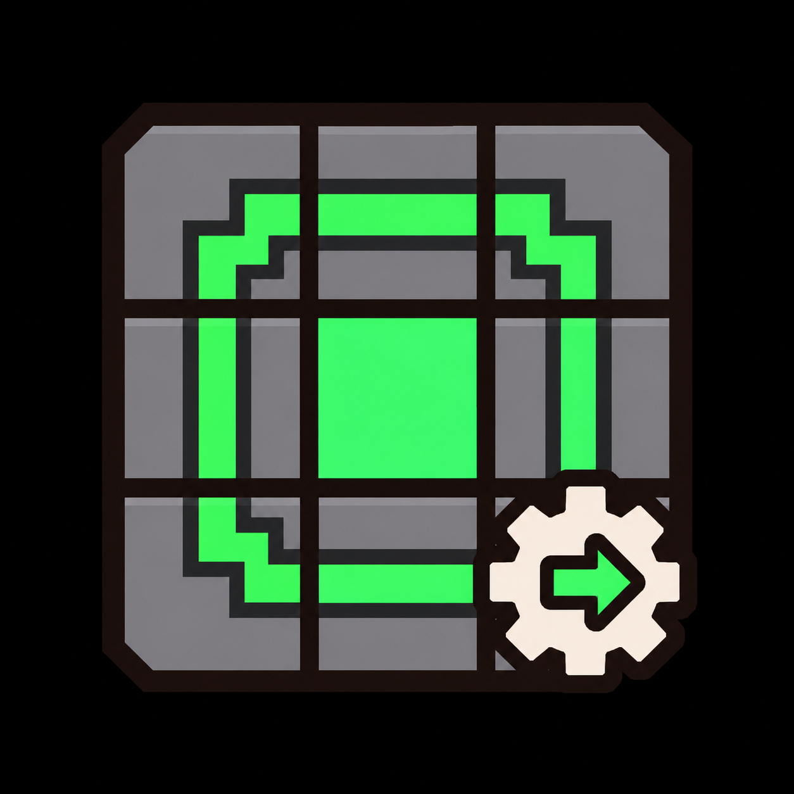
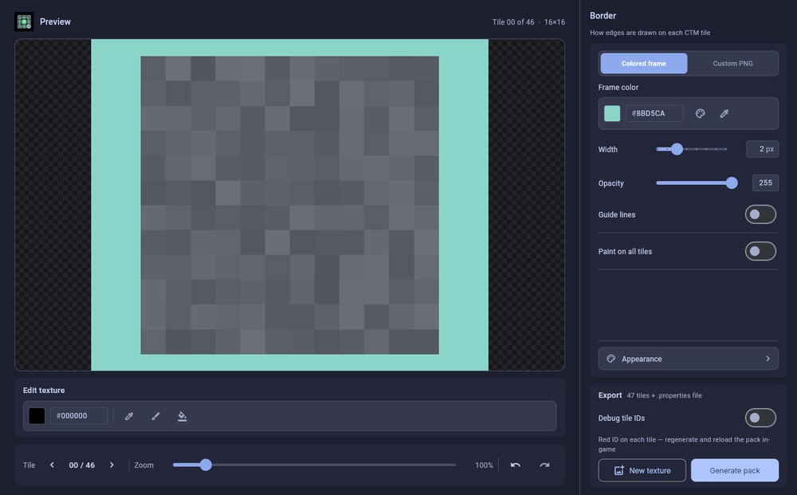

<div align="center">



# CTM Generator

Create and edit 47-tile connected textures from a block PNG.


[](https://github.com/oNxZero/CTM-Gen/actions/workflows/checks.yml)

</div>



Choose a border, check the connections, make any paint edits, and export the
PNG tiles with their OptiFine `.properties` file.
[Watch the walkthrough](https://youtu.be/WXpYSz8xrRo) for a longer guide.

## Run it

Requires **Python 3.10 or newer** and Git. Clone the repository:

```sh
git clone https://github.com/oNxZero/CTM-Gen.git
cd CTM-Gen
```

**Windows — PowerShell**

```powershell
py -3 -m venv .venv
.\.venv\Scripts\python.exe -m pip install -r requirements.txt
.\.venv\Scripts\python.exe main.py
```

**Linux**

```sh
python3 -m venv .venv
.venv/bin/python -m pip install -r requirements.txt
.venv/bin/python main.py
```

On Linux, native file dialogs need your distribution's `zenity` package.

## Make a texture

1. **Open a block PNG**, or start with **New texture**. Name it after the Minecraft
   texture you want to match: `sand.png`, for example, exports `matchTiles=sand`.
2. Choose **Colored frame** for an adjustable border, or **Custom PNG** to load
   an outline image with a transparent center.
3. Step through the tiles and check their edges. Use Pick, Paint, or Fill to
   edit one tile; enable **Paint on all tiles** to edit their shared source.
4. Click **Generate pack** and choose an output folder. Existing output asks
   for confirmation before files are replaced.


For a source named `sand.png`, the export contains:

```text
sand/
├── sand.properties
├── 0.png
├── 1.png
├── ...
└── 46.png
```

Copy the `sand` folder into your resource pack's CTM directory:

```text
assets/minecraft/optifine/ctm/
```

Older MCPatcher-style packs use `assets/minecraft/mcpatcher/ctm/` instead.
Use the layout your target Minecraft version and CTM loader expect.
The export contains textures and a rule; add it to a resource pack with a
suitable `pack.mcmeta`. Minecraft needs a loader that supports
[OptiFine's 47-tile CTM format](https://github.com/sp614x/optifine/blob/master/OptiFineDoc/doc/ctm.properties).

## Preview and editing


| Control | Action |
| --- | --- |
| Left / right arrow | Previous / next tile |
| Ctrl + scroll, or `[` / `]` | Zoom |
| Right-click drag | Pan |
| Ctrl + Z | Undo paint edits |
| Ctrl + Y or Ctrl + Shift + Z | Redo paint edits |

The zoom slider runs from 50% to 500%. Guide lines show where borders are cut.
**Debug tile IDs** stamps the tile number onto each exported image for checking
connections in-game. Turn it off and export again when finished.

Seven themes are available under **Appearance**, including Moonlight, Light,
Catppuccin, and Nord. Settings and the last output folder are saved in
`~/.config/ctm-generator/settings.json`.

## Weird faces or broken connections in-game

**Check block rotations too.** Minecraft randomly rotates some blocks' models,
including sand. A texture can look right in the generator but have mismatched
edges in-game because neighboring blocks use different rotations.

For **Minecraft 1.21.1**, add this file to your resource pack to give sand one
unrotated model:

`assets/minecraft/blockstates/sand.json`

```json
{
  "variants": {
    "": {
      "model": "minecraft:block/sand"
    }
  }
}
```

For another block, use its blockstate filename and model. Keep any required
state variants for blocks with properties such as facing or axis.

If your Minecraft version uses the older `normal` blockstate format, use:

```json
{
  "variants": {
    "normal": [
      { "model": "sand" }
    ]
  }
}
```

If rotation is not the cause, enable **Debug tile IDs**, export, and check the
numbers on the affected faces. Also check that `matchTiles` in the `.properties`
file names the texture you are replacing.

## Development

```sh
python -m unittest discover -s tests -v
```

The demos are captured from the app using a generated sample texture.
To recapture them, run `python tools/capture_demo.py` with a desktop session and FFmpeg installed.

Built with [Flet](https://flet.dev) and [Pillow](https://python-pillow.org).
The Moonlight palette comes from [Moonlight](https://github.com/oNxZero/Moonlight).
Tile-indexing inspiration: [Rostezkiy's generator](https://github.com/Rostezkiy/Minecraft-Connected-Textures-Generator-CTM).
License: MIT.
